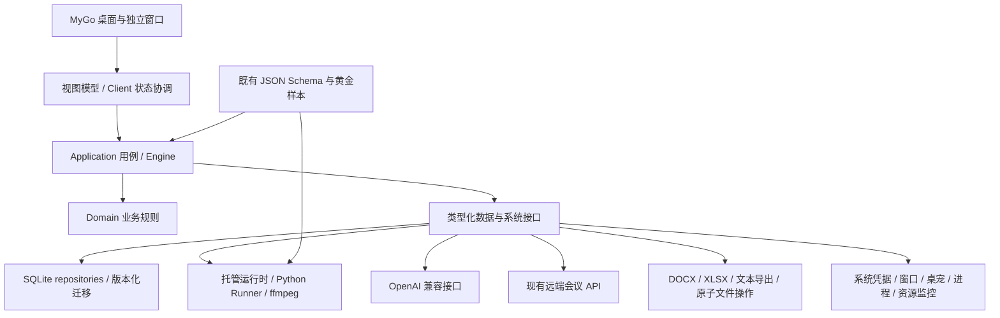

# Liberty Go + MyGo 原生桌面重构方案

文档类型：设计（含实施阶段与验收计划）<br>
状态：已确认，执行中。阶段证据截至 2026-11-17，后续验收见[实施记录](../plans/2026-11-17-native-desktop-implementation.md)。
创建日期：2026-11-16<br>
最后核实：2026-11-21（复核旧端退役终态与发布就绪规则；原阶段证据范围未重新验收）<br>
适用范围：Liberty 1.1.24，基线提交 `1abc624d`；macOS Apple Silicon / Intel、Windows x64 / x86<br>
权威边界：本文描述已确认的迁移目标、约束和阶段证据；新端现提供隔离预览与持久候选包，不能据此替代生产发布或证明全量业务验收完成；当前产品行为仍以现有代码、契约、运行时清单及正式文档为准。
依据：本仓库当前源码和完整检查；Sailry 提交 `1b241caa1253740a26a6142b20df27570648cef3`；MyGo 提交 `eadf1fce6af3bdb9f7cacf649823de2bee2737f2` 的源码与最小程序交叉编译。

> 当前实现的模块职责、单一生成源和已修正契约见[原生架构](../../architecture/native-desktop-architecture.md)，实际启动与恢复见[原生模块说明](../../../apps/native/README.md)。本设计的阶段表和当时检查不自动随代码更新，也不能替代[发布验收](../../architecture/release-readiness.md)。

## 1. 目标与推荐决策

将 Liberty 的桌面主体迁移到 **Go + MyGo 原生自绘 UI + 独立应用服务 + SQLite**。保留 Python 3.10.17、FunASR、ffmpeg、现有模型资源与远端会议协议，完成现有全部业务的迁移和验证后，才替换默认客户端。

这里的“完整重构”指应用壳、界面、状态协调、业务服务、数据访问、平台适配和构建发布链路都纳入迁移，不能以能够打开一个窗口或显示任务列表作为完成依据。

推荐**确定最终架构，按业务模块替换，通过同一组业务样本对照新旧实现**。实施期间冻结旧版，作为迁移对照和现行生产入口；新版使用隔离验收数据。达到全量等价与平台验收条件后切换入口，并在同一退役变更中删除旧版源码和发布链，不设置长期兼容期或双轨发布。

以下是本方案采用的范围假设：

- “参考 Sailry”包含采用 Go + MyGo 技术路线，而不只是调整现有 React / Rust 的目录。
- “业务不变”覆盖会议主流程、设置、远端兼容、桌宠和全部本地玩法；保留已存数据、规则、导出语义和中英文支持。
- 保留现有信息架构、关键操作路径、主题与素材。系统控件细节可随平台适配；不借重构调整产品布局或降低已有动画表现。
- 保留当前四平台范围及各自的运行时支持限制。Windows x86 仍需单独验证，不能因 Sailry 未发布 x86 而默认取消。
- 目标业务实现以 Go 为主。桌宠等平台能力必要时可以保留窄范围原生模块；保留模块必须列明职责、ABI、构建与测试，不把大块旧业务永久藏在桥接层中。

## 2. 设计时系统核实结果（2026-11-16/17 基线）

| 项目 | 当前事实 | 对重构的影响 |
| --- | --- | --- |
| 版本 / 基线 | 1.1.24 / `1abc624d` | 迁移对照固定到可追踪版本 |
| 桌面 | React 19、TypeScript、Vite、Tauri 2、Rust | TSX/CSS 和 Tauri command 不能直接转换成 MyGo UI |
| 规模 | 前端 TS/TSX/CSS 130 个文件、34,789 行；Rust 源码 104 个文件、38,998 行 | 含测试与样式，作为范围参考，不直接折算工期 |
| 导航 / 命令 | 25 条路由（含重定向）、90 个注册 command、8 个 capability 文件 | 必须逐项建立迁移映射；不是仅迁移几个主页面 |
| 数据库 | `liberty.sqlite3`，schema v10 | 保留旧库、迁移顺序、运行记录和业务流水 |
| 转写 | 托管 Python 3.10.17、FunASR、ffmpeg；Runner V2 JSON Lines 及结果 / 进度文件 | 更换桌面框架不等于更换 ASR 引擎 |
| 恢复能力 | attempt / lease、进程身份、心跳、删除事务记录、总结恢复 | 迁移任务执行器必须保留失效结果隔离和崩溃恢复 |
| 凭据 | Keychain / Credential Manager；数据库保存引用；存在凭据清理重试 | 保留服务名、引用语义和失败补偿，不能改成明文配置 |
| 桌宠 | macOS AppKit 原生实现、Windows GDI/Win32 | 透明窗口、拖拽和多屏不能只用普通 UI 组件替代 |
| 盲盒视觉 | Three.js / WebGL，包括透视、粒子、奖品纹理与阶段动画 | MyGo 的 2D UI GPU 后端不自动具备等价 3D 场景能力 |
| 远端会议 | `liberty-meeting` v1 能力协商；不同操作按 capabilities 开放 | 保留实际可用操作及不可用状态，不从宣传文字推断功能 |

当前源码和文档有需要注意的差异：

- 根 README 的主要能力列表未充分展开农场、牛马市场和三类打工小游戏；当前路由、repository 与 `docs/pet-system.md` 已包含这些业务，应全部纳入迁移。
- `docs/architecture/` 的架构和发布文档标注最后核实于 2026-08-27，不能将其全部描述直接当作当前行为。比如模型列表当前使用 `AiModelMetadata`，应沿用元数据与凭据分离的当前实现。
- 远端 README 的概括比实际适配器宽。重构需要以 `meetingApi.ts`、`local_remote.rs` 和具体调用入口为准逐项核实，不能顺便新增远端上传、总结或导出能力。

### 已完成验证与证据边界

- `pnpm check` 已通过：契约检查、前端类型检查、47 个前端测试、Python lint 和 11 个 Python 测试、Rust fmt/test、Web 构建、Clippy 与 release 检查。
- 初次检查因本地缺少 Rollup 原生可选依赖失败；使用 `pnpm install --frozen-lockfile` 补齐后重跑通过，未修改依赖声明和锁文件。
- 固定上述 MyGo 版本、使用 Go 1.27.4，包含 SQLite 的预览程序和全部原生测试包已交叉编译到 darwin/arm64、darwin/amd64、windows/amd64、windows/386；主程序 Mach-O / PE 架构校验通过。
- Rust 实际 schema/repository 生成的合成库已与 Go 对照：14 个可见任务、逐字稿/说话人结果、首页聚合和 765 组等级边界一致。读取前后数据库哈希相同。
- 此前的 macOS 合成窗口证据覆盖不同批次预览布局；当前布局确实观察到首页显示、队列文件名搜索与独立结果打开/关闭。旧批次的范围/分页/英文操作不能替代当前布局复验；尚无完整 UI 等价或性能提升证据。
- Go 格式、模块校验、vet、单元测试、race 检查通过。CI 配置已增加 Go 检查/差分/race/目标编译；GitHub CI 尚未实际执行。`pnpm check` 仍覆盖原技术栈，Go 单独使用 `pnpm native:check` 等命令。
- macOS ARM 已完成真实固定运行时安装、离线模型验证和说话人关闭/开启两种合成语音转写烟测；GUI 整条媒体流程、Windows/Intel Mac 实机、签名/公证/安装器未验证。Go 的漏洞扫描已接入现有 OSV 清单，但本机未安装真实扫描工具；许可证发布包归集尚未完成。

## 3. 参考 Sailry 的范围

| 参考内容 | Liberty 的落点 |
| --- | --- |
| Go + MyGo 原生桌面 UI | 共用 Go 界面代码；macOS Metal、Windows D3D11 |
| Desktop / Client / 执行服务分离 | 界面只持有交互状态；Client 协调查询和订阅；应用服务持有业务执行 |
| 进程内本地调用 | 默认本地路径使用类型化接口；无需为了分层引入 HTTP |
| SQLite 持久化 | 继续沿用 Liberty 数据格式和迁移语义 |
| 跨平台基础设施 | 文件、进程、凭据、对话框、资源路径、窗口分别适配 |
| Go 调用必要的原生能力 | 复杂桌宠能力可通过独立原生模块接入 |

Sailry 的 iroh、设备配对、Agent 团队、MCP、JavaScript 插件系统和 Flutter 手机端不属于本次业务范围。Liberty 继续保留已有远端会议 API；引入新联网或插件体系应另立需求。

Go 的执行服务建议命名 `Engine`，避免 Sailry 的 `Node` 名称与 Node.js 混淆。这里的 Engine 是代码边界，首版仍与桌面运行在同一进程；Python Runner 保持子进程。新增后台常驻服务会改变关闭应用后的行为，不能默认引入。

## 4. 目标架构



### 各层职责

- **Desktop**：布局、菜单、键盘、输入法、焦点、无障碍、窗口协调。禁止直接执行 SQL、启动 Runner 或请求 AI。
- **Client / ViewModel**：任务列表与详情投影、订阅、查询代次、取消与陈旧响应隔离；UI 线程不执行阻塞 I/O。
- **Application / Engine**：创建、重试、删除任务，完成转写、生成总结、安装运行时、导出与发放奖励等用例。长任务生命周期不绑定某个页面。
- **Domain**：状态机、说话人投影、资源预算、成长与奖励、商品限制、签到周期、农场成熟规则、小游戏结算规则、类型化错误。
- **Infrastructure**：SQLite、文件、网络、系统凭据、进程、Runner、时间与随机源、平台图形和运行时安装。
- **Contracts**：延续版本化 JSON Schema；Go DTO 的生成或严格验证方式需统一，避免 TS、Rust、Go 各手写一份互相漂移。

### 建议目录

```text
apps/native/cmd/liberty/             最终原生程序入口
apps/native/cmd/liberty-native/      迁移期间独立入口
apps/native/internal/
  domain/                           纯业务规则
  application/                      用例与 ports
  client/                           状态投影、查询和事件协调
  desktop/
    shell/                          应用壳、导航与窗口
    features/                       与现有业务模块一一对应
    kit/                            可复用控件、主题与无障碍
    i18n/                           中英文消息
  infrastructure/
    repositories/                   SQLite 数据访问
    migrations/                     有序迁移与升级恢复
    runtime/                        下载、校验、安装、验证、预热
    runner/                         进程、JSON Lines、attempt / lease
    credentials/                    系统凭据及补偿
    network/                        目标校验、AI 和远端 API
    export/                         文本、DOCX、XLSX
    platform/                       macOS / Windows 系统适配
  compatibility/                    新旧实现差分与兼容测试
packages/shared-types/              既有跨语言契约
python/funasr-runner/                保留现有 Runner
```

`apps/desktop` 只保留到 Native 切换验收完成。切换前，schema/迁移、运行时清单、模板、消息、素材和兼容黄金样本等必要事实源必须迁入 `apps/native` 或 `packages/desktop-resources`，并从干净检出验证生成和测试；旧端源码不能继续作为这些能力的生成依赖。Native 完成正式切换、启动烟测和资料恢复演练后，退役变更必须删除 `apps/desktop` GUI/Tauri/Rust 客户端、Tauri capabilities、旧端构建与 Release workflow，以及只服务旧端的依赖和治理检查。数据格式升级与兼容黄金样本继续由 Native 维护，但不保留旧 Tauri 可执行程序作为长期回退实现。

## 5. 业务保留与迁移清单

| 业务域 | 必须保留 | 关键验收 |
| --- | --- | --- |
| 工作台 | 聚合指标、趋势、结果完整度、最近任务、资源与宠物概览 | 与旧 SQL 投影结果一致；不加载全部完整逐字稿计算首页 |
| 创建任务 | 本地文件选择、标题、语言、热词、说话人开关、默认设置 | 保留本地单文件语义、输入校验与用户选择路径边界 |
| 任务队列 / 详情 | 来源、搜索、处理状态分组、分页、日志、重试、删除 | 现有搜索包含标题和源文件名；状态分组与每页 10 条的行为应保留 |
| 调度与恢复 | 内存 / CPU 并发预算、持久化快照、事件、lease、进程身份、重启恢复、删除补偿 | 过期进程不覆盖新结果；删除与执行竞争不会复活任务 |
| 结果工作台 | 独立窗口、逐字稿、说话人筛选 / 改名、子窗口、导出 | 同一任务与来源绑定；窗口关闭、替换后旧操作失效 |
| 说话人语义 | ASR 与说话人状态独立；verified / unavailable / failed / legacy 区分 | 旧标签可按现有规则展示，但不能自动提升为已验证结果 |
| AI 总结 | 手动触发、模型 / 模板参数、多次运行、恢复、选中与删除记录 | 不新增自动总结；重复请求、窗口重开、失败重试行为一致 |
| 会议纪要 / 导出 | TXT、Markdown、整包 Markdown、正式 DOCX 模板、人员排序与记录人 | 字段、顺序、中文字体和模板布局对照；失败时不覆盖旧文件 |
| 模型 / 模板 / 人员 | 列表、独立编辑窗口、默认项、Excel 导入导出 | 新旧字段与排序一致；模型元数据不泄露凭据 |
| 运行时 | Python / ffmpeg / 模型分别检测、安装、修复、来源切换、进度与日志 | 真实 URL、SHA-256、平台锁、安装代次和恢复行为保留 |
| 设置 / 诊断 | 外观、主题色、玻璃样式、语言、默认参数、远端配置、资源指标、脱敏日志 | 设置 revision 冲突与运行时私有字段保护不退化 |
| 远端模式 | 能力协商、列表 / 详情 / 结果 / 重试 / 删除 / 改名等实际已开放能力 | 与现有协议、Token 管理及网络目标校验一致 |
| 桌宠 | 原生窗口、拖拽、置顶、多屏位置、动画、互动、设置和多宠实例 | 高 DPI / 多屏 / 睡眠唤醒 / 透明命中测试；失败不阻塞会议主流程 |
| 宠物经济 | 255 级成长、LP、里程碑、商店、库存、装备、食物、礼盒、签到、补签、兑换 | 用固定时间和随机输入逐项差分；重复请求不重复发奖 |
| 盲盒 | 每日次数、奖池、空奖、重复补偿、历史与 3D 动画 | 奖励由业务层确定，动画不得改变或重复结算结果 |
| 农场与打工 | 牛马市场、播种、浇水、成熟、收获、矿场 / 工厂 / 便利店任务、照料与结算；新增主动小游戏体验按 P5-G 独立验证 | 本地时间、期限、消耗、产出和幂等流水一致；游戏渲染/输入不直接结算 |
| 全局交互 | 中英文、自动 / 明暗主题、菜单、对话框、快捷键、输入法、焦点和无障碍 | 两语言与各平台逐流程验证，不只验证点击成功 |

90 个 command 需要建立“旧入口 → 新用例 → 权限策略 → 验收样本”映射。迁移不要求保留 Tauri command 的实现形式，但要求覆盖其全部业务和权限语义。

## 6. 数据、凭据与回退策略

### 数据兼容

1. 初期只对显式选择的**验收快照**运行新实现，生产数据写入仍由现有版本负责。只读访问不等于可以任意复制正在使用 WAL 的数据库。
2. 复制数据库使用 SQLite Online Backup 或在确认无活动写入后制作一致性备份，不能只复制 `.sqlite3` 而遗漏 WAL。
3. 新实现先兼容 schema v10，不因语言变化重建表或修改业务数据。必须覆盖迁移 v1–v10、重复启动、失败重试与未来 schema 拒绝策略。
4. 两个实现使用同一组合成样本和旧库升级样本，对比表内容、业务查询、事件、奖励流水、总结记录和错误语义。样本不含真实媒体、凭据或会议内容。
5. 后续若确需 schema v11+，采用明确的顺序迁移、备份、事务与失败恢复。Go 接管迁移前，旧迁移与凭据转换必须逐项验证；不能同时存在两个互不协调的 schema 管理者。
6. 切换真实资料目录前，新旧程序必须具备**跨可执行文件的同一资料目录所有权锁**。现有 Tauri 单实例插件不能直接证明不同 Go 程序也被互斥。

### 凭据兼容

- 保留 `LibertyDesktop` 服务名与现有 credential reference；系统后端仍是 Keychain / Credential Manager。
- 保留“暂存新凭据 → 提交引用 → 清理旧引用 → 清理失败可重试”的顺序。
- 验证新签名身份下的 Keychain 访问与系统授权提示；服务名一致不代表签名访问控制一定无差异。
- 不导出密钥到 JSON，不提供明文数据库回退，错误和诊断不带完整路径或敏感内容。

### 回退

- 迁移开发阶段通过独立数据目录回退，关闭原型即可继续使用原版。
- 正式切换前停止旧进程及受其管理的 Runner，确认锁释放，制作一致性备份，再交由新实现获取所有权。
- 若新版本保持旧格式且已验证双向兼容，可退出新版本后回退旧程序；否则回退必须使用切换前备份，并明确新版本期间新增数据的保全 / 导出方式。
- “有备份”不能证明可无损回退；发布前需要演练含转写记录、总结、凭据引用和宠物流水的恢复过程。

## 7. UI 与平台专项

### 多窗口和权限

保留主窗口、结果工作台、AI 总结、会议纪要、模型 / 模板 / 人员编辑和商品详情的职责边界。MyGo 原生界面没有 Tauri capability 的同一机制，因此权限必须在新应用服务中重建：

- 窗口角色和结果作用域由窗口管理器签发，绑定来源、job ID、代次与生命周期。
- 接受用户动作的用例验证授权；不能只隐藏按钮。
- 更换任务、关闭窗口、切换来源后，使旧请求和旧订阅失效。
- 文件导出沿用用户授权路径、拒绝链接穿越、临时文件与原子替换。
- 若过渡期存在 WebView 内容，维持隔离、CSP 与窄桥接，不授予任意文件或命令执行能力。

### 桌宠与 Three.js

桌宠先做平台原型，确认透明、置顶、鼠标命中、拖拽阈值、屏幕坐标与缩放。优先让业务和状态迁入 Go；现有可靠的平台实现可暂由明确的原生接口复用，之后再判断迁移收益。

盲盒 3D 场景单独验证两种实施方式：

1. 以自定义原生图形组件重建现有效果，作为全原生目标路径。
2. 在迁移阶段局部嵌入隔离的系统 WebView，保留原 Three.js 场景，业务结算仍只在应用服务中执行。

第二种是过渡保真方案，不能将仍依赖 WebView 的效果宣称为已完成全原生迁移。若原生效果无法达到既有交互与资源预算，记录差异并阻止完整迁移验收；应在目标 Native 架构内修复或明确解决产品范围，不能以长期保留旧版入口代替验收。

### 游戏玩法体验（P5-G）

农场与打工已有真实时间状态和持久化奖励，不应将玩法体验升级误作经济后端重写。当前原生打工主要仍是岗位热区上的开始 / 照看 / 领奖操作，地图与角色帧承担主要的游戏反馈；主动输入、取舍和局内完成条件需要作为独立工作线设计与验收。

P5-G 先以 MyGo 固定版本自带的 `plugins/game` 固定步长循环、输入和相机，在现有窗口内验证一个无经济影响的可玩切片。MyGo 的普通 `ui.Canvas` 和可选游戏插件属于当前 UI 技术栈；单独引入游戏运行时并非制作主动玩法的前置条件。若原型证明 MyGo 绘制或资源工作流达不到具体目标，再评估 Ebitengine 或 Godot，并先解决窗口嵌入、焦点与输入、渲染上下文、包体 / 进程生命周期及四平台分发；尚无实际原型证据前不固定外部引擎。

游戏帧循环只负责游戏表现和本局临时状态。岗位状态转换、照看合法性、奖励及 LP 发放仍由应用用例和 repository 执行；首个切片的评分不改变现有经济。P5-G 与宠物业务的差分迁移分开验收，不阻塞会议核心迁移；完整 P5 仍需在全量整合前完成。范围与验收见[小游戏体验工作线设计](2026-11-19-native-gameplay-experience-design.md)。

### 四平台验证矩阵

| 平台 | 目标 UI 后端 | 必须补齐的验证 |
| --- | --- | --- |
| macOS Apple Silicon | Metal | 中文输入、Keychain、原生窗口、桌宠、多屏、签名 / 公证、ASR |
| macOS Intel | Metal | Intel 实机、GPU / 字体表现、内存、托管运行时与安装 |
| Windows x64 | D3D11 | DPI、IME、Credential Manager、进程回收、桌宠、安装器与运行时 |
| Windows x86 | D3D11，实际可用性待实机验证 | ABI / 指针宽度、窗口、图形后端、内存上限、数据库、独立安装；保持当前 ASR 下载不支持提示 |

MyGo 当前文档明确列出 Windows x64 / arm64；本次 x86 最小程序虽可编译，仍不能代替官方支持和实机验证。若平台原型失败，先解决 Native 适配或纳入有明确职责、ABI、构建和测试的窄范围原生模块；不默认取消平台，也不以旧 Tauri 客户端作为该平台的长期兼容实现或宣称全平台迁移完成。

## 8. 分阶段实施与退出条件

| 阶段 | 主要工作 | 交付物 / 退出条件 |
| --- | --- | --- |
| P0 业务基线 | 路由、command、窗口、schema、设置、运行时、玩法规则清单；关键流程与失败路径 | 可执行对照样本；现有完整检查通过；所有旧功能都有归属 |
| P1 技术可行性 | 固定 Go / MyGo / SQLite 依赖；四平台窗口、输入、凭据、桌宠、3D 和长列表原型 | 四平台实机关键风险有结论；依赖许可证与安全检查；不以最小编译代替验收 |
| P2 核心与只读业务 | Domain、Application、Client、错误与契约；SQLite 只读适配；首页 / 任务 / 结果 | 真正由旧实现生成的合成数据库可被读取；排序、分页、投影和权限差分通过 |
| P3 主流程写入 | 运行时管理、创建 / 重试 / 删除、进程 / lease、任务恢复 | 在隔离目录完整处理媒体；崩溃、旧进程迟到、安装源切换与删除竞争验收通过 |
| P4 结果与配置 | AI、模板、人员、凭据、总结、DOCX / XLSX / 文本导出、远端 API、设置与诊断 | 完整会议闭环与远端契约对照；导出视觉检查；凭据故障恢复通过 |
| P5 陪伴与玩法 | P5-A：成长、商店、签到、兑换、盲盒、农场、打工业务及桌宠迁移；P5-G：独立小游戏体验原型和引擎验证 | P5-A 固定时钟 / 随机输入的业务差分、重复请求与跨日验证、平台视觉交互通过；P5-G 至少一款小游戏通过输入/暂停/结束/重开与经济不变验收，并记录渲染路线的窗口及平台证据 |
| P6 全量整合 | 全部页面 / 多窗口、中英文、主题、快捷键、无障碍；性能与稳定性 | 功能清单全覆盖；关键故障用例全通过；各目标平台原生验收 |
| P7 切换与退役 | 资料目录所有权、升级 / 恢复、CI、SBOM、四平台打包、签名 / 公证；迁出所有旧端生成事实源并验证独立 Native 测试夹具 | 所有平台、业务、安全和发布门槛通过；完成 Native 生产切换烟测与资料恢复演练后，在同一退役变更中删除完整旧 React/Tauri 客户端、旧发布链及仅供旧端使用的依赖；不保留双轨发布 |

主依赖链为 **P0 → P1 → P2 → P3 → P4 → P6 → P7**。P5-A / P5-G 依赖 P1 的平台结论和 P2 的业务 / 数据接口，需在 P6 完成前闭环；P5-G 不阻塞 P2–P4 的会议主链路。这里描述技术依赖，不代表已安排并行 Agent 或人员。

阶段中的页面和控件需要随对应业务一起完成，避免出现只有后端或只有静态 UI 的“完成”状态。当前原生端已完成只读核心、契约校验、Runner 解析、结果窗口能力边界和旧库差分，但仍未达到 P2 退出条件。

不在 P1 之前承诺固定完成日期：原生 3D、桌宠平台适配和 Windows x86 的结果可能显著改变工作量。P0/P1 完成后，再按各业务验收项估算实施与测试工期；时间安排单列平台实机、签名、公证和回退演练，不只统计编码。

## 9. 验证体系与最终完成标准

### 自动化与差分

- 保留现有 TS、Rust、Python 检查；迁移完成前不删除旧测试作为“降低维护成本”。
- 新增 Go 格式检查、`go vet`、单元 / 集成测试，适用平台运行 race detector；支持目标分别构建。
- 跨语言黄金样本覆盖 Runner V1 兼容 / V2、数据库升级、错误、说话人投影、总结选择、导出内容与宠物经济。
- 以真实旧 repository / migration 产生合成数据交给新实现验证；只在 Go 测试里手写简化表不能证明旧库兼容。
- 故障注入覆盖断网、下载损坏、磁盘不足、凭据访问失败、写入失败、Runner 崩溃、过期结果、重复奖励、用户关闭窗口与重启。
- 文档输出同时检查语义与布局，DOCX / XLSX 不要求压缩文件字节完全相同，但字段、顺序、格式和可打开性必须保持。

### 性能

分别测量空闲桌面、长任务列表 / 长逐字稿、多个结果窗口、桌宠 / 盲盒动画、单个与并发 ASR：冷启动、CPU、峰值 / 空闲内存、交互延迟和进程树资源。

现有 ASR 的 2 GiB 系统预留、每 Runner 4 GiB 估算与线程分配策略保留。GPU 绘制 UI 不会自动加速 Python 转写。性能对照必须使用同设备、同数据、同模型与相同采样口径，实测前不承诺包体 / 内存降低百分比。

### 供应链与发布

- MyGo、Go、SQLite 和原生依赖固定版本；Go 校验和纳入锁文件管理。
- 补充 Go 依赖漏洞与许可证检查，并将 Go 和保留的原生模块纳入 SBOM；现有 Cargo / pnpm / Python 扫描覆盖不能冒充新栈覆盖。
- 保留现有发布 quality gate、固定 Action SHA、最小权限、资产校验与 release 身份绑定。
- 程序版本继续与仓库发布版本一致，按平台区分资产与运行时；依赖工具版本与产品版本分别管理。
- 生产入口切换前同步正式 README、架构文档、开发命令、发布检查和 AGENTS 适用规则，过程文档不能成为新系统唯一说明。

### “完整重构完成”的判定

以下全部满足，才能声称完成：

1. 25 条旧路由对应的功能或重定向均有明确去向，90 个 command 的业务与授权语义全部覆盖。
2. 所有业务保留表中的流程通过，包括农场、打工和桌宠，不以主会议流程可用替代全业务完成。
3. 旧库、设置、凭据引用和运行时能够接续，升级失败与回退经过验证。
4. 任务执行、恢复、导出及奖励流水通过一致性和故障测试。
5. 四平台达到各自已承诺的支持级别；任一平台未完成时都不能切换，也不能以旧 Tauri 兼容路径计入全量完成。
6. 中英文、主题、输入法、多窗口、无障碍和动画验收通过。
7. 新栈进入 CI、安全 / 许可证检查、SBOM 与发布验证，且不存在空实现或伪成功路径。
8. Native 替代实现验收、正式切换烟测和资料恢复演练通过后，旧生产入口在同一退役变更中删除；不为旧端保留长期兼容或双轨发布。构建、发布和部署仍按对应授权分别执行。

## 10. 设计时工作区状态（历史快照）

用户已确认执行方案。当前分支为 `codex/native-architecture`，未提交、未推送、未发布。

当前新增 `apps/native` Go 模块、首页/任务/结果只读接口、共享契约离线校验、Runner V1/V2 解析、Client 协调、MyGo 预览和窗口能力对象。Rust 夹具由现有 schema/repository 生成，`pnpm native:compat` 已通过；新增 CI 检查与 Go 校验和、OSV、SBOM 覆盖，原生端尚未接入默认客户端或发布打包流程。

原型已覆盖任务队列过滤/分页、日志/总结选择、当前 lease 的实时进度和主要 UI 结构；完整 DTO、全部结果标签页与原版视觉验收仍缺。P3 已接通显式隔离可写模式下的资料目录锁、事务写入、执行/调度/恢复/删除补偿、新建/重试/删除 GUI，以及运行时下载/校验/安装代次、模型离线预热和环境页面。旧 schema 上的整条合成子进程流程、运行时状态机、TLS 合成安装及 macOS ARM 真实运行时/合成语音测试已通过；GUI 整条媒体流程、其他平台运行时、v1–v10 升级和凭据迁移仍待验证/实现。AI、导出、宠物写入和远端仍未迁移；不能将隔离预览或合成执行测试计为完整重构完成。阶段记录见 [实施计划与验收记录](../plans/2026-11-17-native-desktop-implementation.md)。

本次未读取或修改用户本地业务数据库与凭据；默认 React / Tauri 入口保留，启动装配新增跨可执行文件的资料目录所有权锁。

## 11. 参考来源

- [Liberty README](../../../README.zh-CN.md)
- [原生架构](../../architecture/native-desktop-architecture.md)
- [发布标准](../../architecture/release-readiness.md)
- [宠物 / 农场 / 打工业务规则](../../pet-system.md)
- [当前路由](../../../apps/desktop/src/app/router/index.ts)
- [Rust 注册入口](../../../apps/desktop/src-tauri/src/lib.rs)
- [数据库迁移](../../../apps/desktop/src-tauri/src/local_db/schema.rs)
- [跨语言契约](../../../packages/shared-types/README.md)
- [运行时事实来源](../../../packages/desktop-resources/runtime/runtime-manifest.json)
- [Sailry 架构，固定提交](https://github.com/sailry/sailry-harness/blob/1b241caa1253740a26a6142b20df27570648cef3/ARCHITECTURE.md)
- [Sailry 依赖，固定提交](https://github.com/sailry/sailry-harness/blob/1b241caa1253740a26a6142b20df27570648cef3/go.mod)
- [MyGo 平台说明，固定提交](https://github.com/egoist/mygo/blob/eadf1fce6af3bdb9f7cacf649823de2bee2737f2/docs/README.md)
- [MyGo macOS 渲染入口](https://github.com/egoist/mygo/blob/eadf1fce6af3bdb9f7cacf649823de2bee2737f2/ui/gpu_darwin.go)
- [MyGo Windows 渲染入口](https://github.com/egoist/mygo/blob/eadf1fce6af3bdb9f7cacf649823de2bee2737f2/ui/gpu_windows.go)
- [MyGo 游戏插件文档，固定提交](https://github.com/egoist/mygo/blob/eadf1fce6af3bdb9f7cacf649823de2bee2737f2/docs/plugins/game.md)
- [小游戏体验工作线设计](2026-11-19-native-gameplay-experience-design.md)
