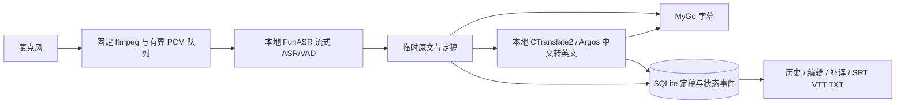

# FunASR 升级与本地边听边译方案

文档类型：设计 
状态：已确认；隔离升级、P1/P2 已实现，本机功能及两小时稳定性通过 
创建日期：2026-11-25 
最后核实：2026-11-26 
适用范围：`apps/native` 原生候选、FunASR 隔离升级、麦克风中文→英文字幕 
权威边界：记录已选方案与实施边界；不证明生产切换、通用翻译质量、8 GiB 或三平台实机验收。当前行为以源码、共享 manifest 和[实时翻译说明](../../live-translation.md)为准。 
依据：当前 application/client/desktop/managed/runner 实现、共享协议/schema v11、下列固定上游来源与本机隔离验收。

## 已确认的产品方向

用户要求无需第三方配置或 API Key。识别与翻译全部本地运行，Liberty 管理首次下载、完整性检查、启动和退出。FunASR 的 Paraformer 负责识别，并不承担当前这条链路的跨语言翻译；后者使用单独的本地机器翻译模型，用户无需选择服务商。

首版采用麦克风中文输入→原文与英文字幕。英语输入、系统声音、混合采集、悬浮字幕和译文朗读留待后续。Windows 真机按既有要求暂缓，签名、公证不在本次工作范围；跨目标编译不能代替实机结果。

原先“使用用户配置的在线翻译服务”的设计已经被上述产品决定替代，对应传输实现与配置入口已移除。总结功能已有的模型管理独立保留，不是实时翻译的依赖。

## FunASR 更新判断

2026-11-25 核实的 [GitHub v1.4.29](https://github.com/modelscope/FunASR/releases/tag/v1.4.29) 与 [PyPI 1.4.29](https://pypi.org/project/funasr/1.4.29/) 发布于 2026-11-23；源码提交 `ea49266c17efc980bd1b39aabae49967a02cc8b2`，官方 wheel SHA-256 `3a9c233218c12fce95fb15717cc881c30a223877f5c6809e33256b1aa57c56e7`。

累积修复涉及时间戳、空结果/零时长 VAD、数组音频、热词、说话人与流式缓存。1.4.29 修复末尾 CIF 帧的 token 时间戳。来源为[固定版本更新记录](https://github.com/modelscope/FunASR/blob/v1.4.29/README.md#whats-new)。没有足以证明 Liberty 整体更快、更省内存或识别更准的上游对照基准，升级理由主要是正确性与维护性。

当前保留两项独立决定：

- 默认生产仍为 `1.3.9+liberty.local2`，现有四个离线模型 revision 不变。
- 显式 `funasr-upgrade` 候选固定 `1.4.29+liberty.local1`，新增 `rapidfuzz==3.14.6` 与 `websockets==17.4`，三平台依赖哈希锁定。local1 仅修改依赖元数据与版本记账；Python 源码保留官方内容。候选安装目录、输入和 profile 独立，不能混用旧 wheel 摘要。

候选制作与验证命令见[正式开发说明](../../live-translation.md#funasr-升级候选)。新旧版本都已执行公共短音频流式识别；这只支持基本兼容性，不能替代 CER/WER/DER、长音频与目标平台验收。生产切换仍需通过[既有 ASR 门槛](../../../benchmarks/asr/thresholds.json)。[Torch 例外](../../../python/funasr-runner/osv-scanner.toml) 的 20 项仍在，到期日 2026-11-30；不因升级 FunASR 自动消失或延期。

## 已实施链路

- 麦克风通过 macOS AVFoundation / Windows DirectShow 采集，复用已锁定 ffmpeg 与进程管理；采用 build tags。原草案的 CoreAudio/WASAPI 原生桥接没有实施。
- PCM16 单声道 16 kHz，采集 100 ms，ASR 600 ms，VAD 200 ms。采集和识别输入各 25 帧，约 5 秒有界缓存；落后即报告失败并保留定稿。持续讲话 12 秒强制分段，长静音定期清理 VAD 缓存。
- 会话复用 ASR/VAD 与翻译进程，文件 ASR 和实时 ASR 互斥。识别预热完成才打开麦克风。暂停关闭采集并刷尾部，模型保持加载；结束或应用退出刷尾句并回收进程树。
- 翻译对定稿异步执行；失败不阻塞原文，可在结束后补译。CPU int8 单线程；源文本 8192 字节/512 token 上限，拒绝静默截断，输出有上限，启动 30 秒与单段 20 秒超时。
- 音频不落盘、不上传；原文和译文都不发网络。实时翻译无需凭据，首次模型下载后可离线使用。
- 可见列表仅最近 100 个定稿和一个临时片段，MyGo 虚拟列表；历史分页。隐藏/最小化降低 UI 轮询频率但继续收听。标题栏使用实际客户端及子进程 CPU/内存。
- schema v11 使用共享 SQL 新增会话、片段和状态事件，Go 与保留 Rust 都注册迁移。revision 隔离旧编辑和迟到翻译，启动恢复标记中断；不伪造流式缓存续听。早期候选的 `glossary` 列保留兼容，产品不暴露术语表。

分层保持 `domain` 规则、`application.LiveService` 编排、`client.LiveController` 异步状态、`desktop.LiveView` 渲染，基础设施负责采集、进程、模型和 SQLite。文件 Runner v2 不变；新增独立 ASR 与翻译 v1 JSON Lines 契约，旧 GUI 不消费这些协议。

## 模型和供应链

| 角色 | 已选输入 | 边界 |
| --- | --- | --- |
| 流式识别 | Paraformer online，revision `70e272c03055313e90f34db80bef9c19745e41cf` | 中文；Apache-2.0；额外权重约 840 MiB |
| 翻译 | Argos `translate-zh_en-1_9`，原始归档约 71 MiB | 中文→英文；OPUS-MT 衍生模型，CC-BY-4.0 |
| 翻译引擎 | CTranslate2 4.9.1，官方 CPython 3.11 三平台 wheel | CPU int8 单线程；引擎 MIT；原生内嵌库须另做完整分发许可审查 |

归档和展开文件的 SHA-256/大小在[共享 manifest](../../../packages/desktop-resources/runtime/runtime-manifest.json)锁定，拒绝额外文件、符号链接和哈希漂移。翻译 Python 使用 `-I -B`；现有锁提供 NumPy、PyYAML 和 SentencePiece。CTranslate2 加入三平台漏洞扫描及源码 SBOM；这是包级扫描，不能声称覆盖 wheel 内每个原生库。归因与许可链接见[notices](../../../packages/desktop-resources/runtime/live-translation-NOTICES.txt)。

实际短句实验能生成译文，但金额样例出现“元”被译为美元符号的错误。当前没有通过会议领域人工评审、数字/币种/人名/术语准确率门槛，不能把示例成功当作质量结论。保留原文与编辑功能；不进行无法可靠验证的自动币种修正。

## 阶段和验收边界

| 阶段 | 当前状态 | 尚需证据 |
| --- | --- | --- |
| P0 升级与模型 | 候选隔离、可复现 wheel、三锁、实跑短音频已实现 | 对照语料 CER/WER/DER、8 GiB、Intel/Windows 实机；默认生产尚未切换 |
| P1 实时原文 | 采集、预热、端点、暂停/恢复/停止、保存与恢复已实现 | 本机两小时曲线已记录；更多麦克风/权限/拔插与目标设备场景 |
| P2 本地边听边译 | 本地译文、历史编辑、失败补译、双语导出已实现 | 本机两小时已通过；领域译文人工评审与分发许可闭环 |
| P3 扩展输入/显示 | 未实施 | 系统声音、混合输入、悬浮字幕、回声和时间轴验收 |
| P4 译文朗读/更多语言 | 未实施 | 独立语言模型、TTS、质量与平台验证 |

验收区分基本链路、质量、性能和平台：真实公共音频按墙钟喂入，验证 partial/final、离线译文、SQLite、导出和重开；两小时回放检查有界快照/积压、定稿完成和退出释放。CPU 按单核 100%，macOS 内存用 physical footprint，Windows 用 working set；测试服务进程树不能冒充 GUI 整体测量。600 ms 是音频块大小，不是端到端延迟承诺。

延迟目标仍需按机器档位解释：语音结束→定稿 P95 1.5 秒，定稿→译文 P95 2 秒，语音结束→译文 P95 4 秒。译文语义用人工对照，不仅检测有无字符串。完整质量、兼容、race、跨目标编译与实际安全扫描各自记录，不互相替代；未覆盖项保持“未验证”。

本机功能、禁网链路、队列修复与两小时回放结果见[2026-11-26 验收记录](../reviews/2026-11-26-local-live-translation-acceptance.md)。这是本机稳定性证据，不能替代上述质量与平台门槛。
