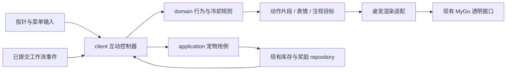

# Liberty 桌宠互动与 3D 升级方案

文档类型：设计<br>
状态：已授权执行；用户确认当前像素外观与同步播放，15 组已接入 macOS 原生预览；正式客户端、P0 互动与平台验收未完成<br>
创建日期：2026-11-25<br>
最后核实：2026-11-26<br>
适用范围：`apps/native` 的 Libby 桌面宠物、现有宠物服务及共享模型资源<br>
权威边界：本文区分当前代码事实、建议与待验证目标；macOS 小样不代表正式模型、完整骨骼动画、性能达标或跨平台验收。<br>
依据：当前 `companion.go`、`pet.go`、素材生成器、15 组原动作的全部 135 帧对照、原生架构与宠物规则，以及文末上游资料。当前行为仍以源码、测试及正式文档为准。

## 已确认的制作方向

用户已明确要求“根据每个动作的原图制作 3D”。全部 15 组现有动作纳入最终交付范围，逐组保留关键姿态、表情、服装、道具和动作含义。原图中的 Libby 是穿羊毛头套的拟人角色，应保留其羊角、毛绒头套、脸型和头身比例，不能改造成写实四足羊或另一套通用吉祥物。

2026-11-26 用户试看圆润卡通版后明确否定其造型，最新要求为**恢复之前的立体像素版**。随后用户要求其余动作全部按像素风 1:1 制作。当前已生成 15 组候选与全动作预览；共享背面配色已调整为羊毛白色／对应部件颜色，原捧脸资产作为回归基准保留。九个关键姿态已制作并逐帧对照，细节与帧间接触仍需验收，不能把用户授权实施当作外观认可。

制作采用“统一角色本体和兼容骨架 + 各动作的服装／道具场景 + 独立动画片段”。共用技术资产服务于形象一致和资源控制，不减少用户要求的动作。原图未展示的侧面、背面、被遮挡结构需要补充设定，在模型审核时单独标识；不能声称从有限二维图精确还原这些未知部分。

核心升级是：用户的触碰位置、速度、当前工作状态和最近互动能够改变同一个角色的行为。新增模型本身不会自动增加可玩性。

WebGL 可以渲染真实三维网格、骨骼与表情；每个动作可以成为同一骨架上的动画片段，再与视线、表情和道具约束组合。WebGL 不负责建模或自动生成动作。PNG 也不是过时格式，3D 仍可能使用 PNG 纹理；当前受限的是固定视角、低帧率、动作切换和交互反馈的表达方式。

产品建议优先原生 3D 接入评估，保留 MyGo 的窗口、主题与控制器。Three.js + WebGL2 适合先验证同一 GLB 资产和动作效果；若作为正式桌宠则需要浏览器执行环境与宿主接入，这是新增架构成本，不能因演示可运行就直接引入发布端。

## 已核实的现状

| 证据 | 当前事实 | 升级着力点 |
| --- | --- | --- |
| [桌宠窗口](../../../apps/native/internal/desktop/companion.go) | 320×220 透明无边框窗口；角色区域 148×148；支持点击、拖动、置顶、多开与主实例位置保存 | 保留原生窗口语义，增加身体部位命中和安全的拖拽反馈 |
| [动作选择](../../../apps/native/internal/desktop/pet.go) | 处理状态先于互动事件决定动作；无新事件时约每两分钟切一组动作 | 允许短时用户互动打断工作表现，结束后自然回到工作状态 |
| [素材生成源](../../../scripts/generate-native-pet-art.mjs) | 15 组、135 张动作帧；桌宠动作每 300 ms 换帧，约 3.33 fps | 统一骨架与可插值动画，消除固定序列的生硬跳转 |
| [业务规则](../../pet-system.md) | 已有 tap / pet / feed / encourage、成长、LP、库存、装备、日上限和工作流奖励 | 复用现有事务与上限；表现层不另算奖励 |
| [当前原生架构](../../architecture/native-desktop-architecture.md) | Go + MyGo；应用没有 WebView，渲染主窗口不等于已有通用角色 3D 引擎 | 先验证渲染宿主接口，避免回到旧 Tauri 发布链 |
| 固定 MyGo 依赖中的 rendering / shaders 文档 | macOS 使用 Metal，Windows 使用 D3D11；公开 Shader 主要计算矩形像素，UI 透视变换不等于骨骼网格管线 | Mesh、蒙皮、深度、动画与资源释放需要专门实现或集成 |

这些判断不说明旧 PNG 帧必须全部删除。商店缩略图、徽章和轻量静态预览继续适合栅格图片；本次升级对象是实时桌宠本体。

## 玩法：先做好五种有反馈的操作

| 优先级 | 操作 | 角色反馈与连续过程 | 成功标准 |
| --- | --- | --- | --- |
| P0 | 抚摸头部／身体 | 识别按下后的轻扫；抬头、闭眼、轻蹭，耳朵与铃铛延迟摆动；快速戳动时短暂躲闪 | 同一位置不同动作可辨认；一次手势只形成一次互动事件 |
| P0 | 提起与放下 | 按住身体进入提起姿势，四肢摆动；在屏幕安全区域松开后缓冲落地、站稳 | 与普通点击不冲突；拖拽取消、多屏、缩放变化不丢失指针捕获 |
| P0 | 投喂库存食品 | 从轻量菜单选食品，宠物看向食物、接住、咀嚼、回味；以后再增加食品偏好 | 使用现有库存事务，失败不显示已消费；重放动画不重复扣库存或发奖 |
| P0 | 玩球／逗宠 | 用户在宠物附近的明确互动区投球，宠物转身、短跑、追到、带回 | 一轮约 15–30 秒，可随时退出，不遮挡办公区域；第一版不新增 LP 奖励 |
| P0 | 一起工作与完成反馈 | 工作时阅读或轻敲键盘；用户主动互动可短时打断；持久化任务完成后庆祝一次再回位 | 不抢焦点、不自动代办任务、不读逐字稿内容；同一完成事件不重复庆祝 |

P1 再扩展三个方向：

- **可记住的偏好**：几种食物、玩具及活动的偏好；记忆来自明确互动，不按秒写数据库。性格影响动作选择与反应速度，不引入新的经济倍率。
- **有用途的摆件**：床用于睡觉、球用于追逐、书用于专注陪伴；帽子和铃铛成为模型挂点上的装备。现有装备 ID 与库存保持兼容，每件 3D 配饰单独验收穿模和轮廓。
- **短回合训练**：击掌、找球、节奏跟拍，积累可见的熟练动作；成长奖励如需变更，应先补业务规则与幂等设计。首版可只解锁表现变化。

不设置离线饥饿惩罚或“长时间不打开就受伤”。专注模式主动减少打扰；用户主动发起的抚摸仍可得到安静回应。桌面活动限定在用户选定的区域；跨应用识别窗口边缘、攀爬其他程序窗口另作扩展，不把全屏覆盖层当作默认实现。

## 动作如何变成真实模型表现

一个角色本体共享网格、材质和骨架；每个行为由“基础片段 + 表情 + 少量实时修正 + 道具”组合。GLB 存储资产，行为选择与优先级由应用自己实现。glTF 标准不定义自动循环、行为树或物理规则。

| 行为 | 资产制作 | 运行时组合 |
| --- | --- | --- |
| 呼吸、眨眼、左右看 | 呼吸片段；眼睑与嘴角形变 | 随机间隔触发眨眼，头颈注视目标受角度限制 |
| 走、跑、转身 | 起步／循环／停步片段 | 随速度混合；根节点沿桌面路径移动，脚部贴地修正 |
| 抚摸、鼓励、击掌 | 身体反应片段和开心表情 | 根据触点调整头部与手部目标，结束后 150–250 ms 混回基础状态 |
| 提起、落地 | 悬挂姿势、落地、恢复站立 | 拖动速度驱动轻微摆动；限速与安全区域约束，不做任意高空抛掷 |
| 吃饭、阅读、打工 | 咀嚼／阅读／敲击片段，食品／书／桌面道具 | 手部与道具挂点对齐，接触时刻使用资产清单定义的事件标记 |
| 睡觉、庆祝、玩耍 | 入睡／睡眠／醒来，庆祝与追球片段 | 表情层与耳朵、饰品的小幅弹性跟随 |

现有 15 组动作在技术上都可以重做。先试制三组代表动作验证质量与技术，随后按批次完成其余动作；完整交付不擅自删除、替换或合并原动作。每组可以拆成进入、循环和退出，追加插值保持原图节奏，用户拖动、注视等实时修正叠加在已审核的基础动作上。

## 按原图逐组制作的清单

以下以实际图片而非英文目录字面含义识别动作；135 帧已生成并排／差异对照，完成制作复核，尚未通过完整外观验收。尤其 `snow` 原图是戴皇冠喝饮料，不应按“下雪”制作。目录标识继续保留作为兼容键。

| 现有标识 | 原图表现 | 需要制作的 3D 内容 | 可增加的直接互动 |
| --- | --- | --- | --- |
| `crush` | 捧脸、脸红、爱心眼 | 手贴脸姿势，脸颊／眼睛形变，爱心表现 | 触摸头部或脸颊后回应，轻蹭触点 |
| `defecate` | 坐便器上的如厕表情变化 | 坐便器、坐姿、手腿接触、用力表情 | 轻点后抬头／害羞回应，保留原有幽默 |
| `drive` | 驾驶白色小车 | 小车、方向盘、轮子、坐姿和手部挂点 | 在限定区域操控方向，车轮随位移转动 |
| `eat` | 端碗吃饭 | 碗、餐具、食品、咀嚼与手口接触 | 选择库存食品，注视、接取、进食 |
| `gaming` | 面对显示器玩游戏 | 显示器、座椅、操作姿势、惊讶与兴奋表情 | 轻点触发一段短胜负反应，按预算限制显示器特效 |
| `pants` | 拉扯／整理裤子的搞怪动作 | 对应衣裤、手部抓握和衣物形变 | 轻点触发表情与整理动作，不改变原服装设定 |
| `reading` | 双手拿书阅读 | 原图书本外形、持书姿势、低头眨眼 | 点书翻页、点头部短暂抬头 |
| `rope` | 原地跳绳 | 绳柄、绳索、起跳／落地与手部旋转 | 点击节奏影响下一次起跳，绳脚接触不能穿模 |
| `run` | 正面跑动 | 走跑骨骼循环、转身和停步 | 在宠物附近追随目标或追球 |
| `slack` | 吐舌、伸手等搞怪表情动作 | 嘴部、手臂片段和原图表情节奏 | 轻点不同部位给出对应短反应 |
| `sleep` | 侧卧、闭眼与醒来变化 | 侧卧身体形态、呼吸、眼睑、入睡与醒来 | 轻点唤醒，安静模式保持低频微动 |
| `snow` | 戴皇冠、捧杯喝饮料 | 皇冠、杯子、吸管、双手和口部接触 | 点饮料吸一口，任务完成时使用短庆祝变体 |
| `studying` | 趴在书本前写字 | 书本、笔、持笔手与书写接触 | 与专注会话联动，点击后抬头再继续 |
| `toy` | 坐着玩彩色积木／玩具 | 彩色积木、手持玩具、坐姿 | 选择或递给一个积木，接住、摆放 |
| `work` | 坐在桌椅前使用笔记本电脑 | 桌椅、笔记本、手部敲击和原图表情 | 跟随任务状态；用户触碰可打断后恢复 |

每组验收同时检查两个维度：固定参考视角下与原图的轮廓、道具位置、关键姿态和表情相符；旋转视角及交互时仍有真实厚度、完整背面、正确遮挡和接触。用原图放在朝向镜头的平面上不算本方案的 3D 完成。

首版美术交付建议：

- 1 个 Libby 本体，约 8k–15k 三角面、40–60 根骨骼、约 8 个常用表情；这是资源目标，不是已有资产规格。
- 15 组原动作完整还原，每组按需提供进入、循环和退出片段；提起、落地、转身等互动过渡另计，不能以“15 个 clip”替代完整 15 组行为。
- 道具按上表逐组制作，共用书本、座椅等基础组件时保留各原图外观差异。当前动作的道具按需加载，主体 1K 纹理，优先共用材质。通过几何轮廓和法线表达羊毛，首版不依赖逐根毛发模拟。
- 提供可编辑 `.blend` 源、绑定说明、动作命名、挂点和命中区；动画约束在导出时烘焙，需要响应用户的注视／IK 留在运行时。
- 由生成流程导出 GLB、资产清单与 SHA-256；验证网格、骨骼索引、循环接缝、材质、透明边缘与动画输入。原始授权和可再发行权限跟随资产保存。

资产位置为 `packages/desktop-resources/pet/models/`。根目录保留被否定的图形夹具；当前全套像素候选位于 `candidates/pixel-actions/`，编辑源位于 `source/pixel-actions/`；原捧脸候选仍保留在 `candidates/voxel-study/`。圆润版保留为被否定的造型对照。资源状态和命令见该目录 README。生产客户端目前仍未启用 3D 角色。

## 技术路线与选择门槛

| 路线 | 能做到什么 | 主要代价 | 建议 |
| --- | --- | --- | --- |
| Three.js + WebGL2 | GLB 加载、骨骼／面部动画、混合、射线命中，方便审核动作 | Native 当前没有浏览器宿主；透明合成、输入穿透、焦点、上下文丢失及进程树开销需重新验证 | 首先用于资产验证；作为生产方案须单独证明宿主集成和预算 |
| 原生 3D 适配 + MyGo | 保留当前窗口、控制器和业务服务，按平台使用 GPU | 缺少已经验证的网格接入点；外部纹理、线程与资源生命周期是核心工程风险 | 优先做技术小样，通过后作为主路线 |
| 2D 骨骼／变形 | 可改善平滑度、触摸反馈与素材复用 | 不能提供完整三维转身、体积和接触效果 | 预算受限时的备选，不能称作真实 3D |

原生小样可考察两种库组合，但本草案不锁定或安装任何依赖：

- **Filament** 已提供 glTF 与材质／动画等基础能力，可减少高层功能自研；其原生 API 与图形后端仍需和 MyGo 合成及生命周期对接。它在 Windows 上的后端不等同于 MyGo 的 D3D11，不应假定纹理可以直接共享。
- **Sokol gfx** 提供 Metal / D3D11 等后端，接入范围可以较集中；它是图形抽象层，不自带完整角色系统，仍需加载、骨骼、混合、命中与材质实现。Ozz 可作为动画运行库候选，但会增加 C/C++ 工具链和绑定维护。

第一道门槛不是“模型成功转起来”，而是**同一个 MyGo 透明桌宠窗口中正确呈现并释放资源**。优先验证可维护的渲染接口或原生插件。不要在普通 View 中访问私有后端字段，也不要另建 GLFW/SDL 窗口体系。若必须扩展 MyGo，应明确接口、固定依赖版本与维护责任。

不采用每帧 GPU→CPU 读回→PNG 编码→UI 解码作为正式管线；可以作为定位问题的临时手段，不能当作满足性能目标的集成完成。当前 `native:build:matrix` 使用 `CGO_ENABLED=0`；引入 C/C++ 渲染库会改变构建、库装载、签名与分发边界，必须在小样阶段解决或明确不可行。WebGL 路线同样需要解决宿主和平台分发问题。

## 交互架构与状态规则



建议行为优先级为：拖拽／安全恢复 → 用户主动互动 → 有效任务完成反馈 → 工作陪伴 → 自主待机。专注模式降低自主提醒和庆祝幅度，仍允许用户主动互动。转写进行中，用户抚摸后回到工作姿势；不会因为高优先级工作状态而完全吞掉操作。

把“移动”“上半身行为”“面部表情”分开混合，避免为全部组合制作完整动画。短时输入状态与每帧姿势保存在内存；仅保存位置、装备、偏好与已完成互动，合并写入。渲染器只消费表现快照，不读 SQL、不发奖励、不调用模型服务。

工作事件从已持久化快照／事件发布，按任务和事件身份去重。宠物消费的工作信息限状态和事件码，无需读取会议内容。食物扣减与成长复用现有 application/repository 事务；动画中断、隐藏或窗口销毁不改变已经提交的经济结果。

窗口命中区域应随角色与明确道具区域更新，背景保持穿透。身体命中可先使用投影后的简化头／躯干／四肢形状，避免为所有鼠标移动做 GPU 像素读回。使用同一原生指针捕获和拖拽取消路径；显示器断开、休眠恢复、比例缩放和置顶切换分别测试。

## 性能约束：以下均为拟定验收目标

3D 不保证比 PNG 更省资源。网格与共享动作可能减少帧图保留，持续渲染、纹理、深度缓冲和浏览器宿主也可能增加 CPU、GPU 和内存。必须和**整改后的** PNG 版本在同设备、同窗口尺寸、相同桌宠数量下比较。

| 项目 | 首版建议目标 | 口径 |
| --- | --- | --- |
| 主动互动 | 默认 30 fps，帧间隔 P95 ≤ 33.3 ms，输入反馈 ≤ 100 ms | 拖拽、吃饭、追球等固定脚本；非平均 FPS 单项验收 |
| 安静陪伴 | 微动作约 10–12 fps，静止／睡眠时暂停连续绘制 | 按动作时间线唤醒；不持续空转 60 fps |
| 隐藏／系统休眠 | 停止动画提交与自主行为计时唤醒 | 保留必要业务通知订阅，恢复后重取状态 |
| 单桌宠 CPU | 安静场景新增平均 ≤ 1%，主动互动新增平均 ≤ 5% | 100% 为一个逻辑核；同机关闭桌宠作对照，连续 10 分钟 |
| 单桌宠内存 | 新增 RSS ≤ 80 MiB；macOS 新增 physical footprint ≤ 120 MiB | 两种口径分别报告，包含宿主子进程；目标未实测 |
| GPU 资源 | 首版贴图预算 ≤ 24 MiB，限制材质与绘制调用；默认不用实时毛发和高成本后处理 | 无可靠 GPU 计数时只报告资源清单和分配记录，不冒充实际显存 |
| 会议主任务 | 相同真实转写输入的耗时回退目标 ≤ 3% | 同配置交替对照、多轮测量；长音频与 8 GiB 设备单独验收 |

多开实例共享网格、贴图与动作资源，每实例保留自己的姿势与行为；1 / 3 个实例都测试资源增长与回收。不能每个宠物分别启动一个渲染引擎或 WebView，再按单实例数字宣称低占用。

验证至少包括 30 分钟待机、10 分钟互动、反复换装及开关 20 次、多屏／休眠恢复，以及转写同时运行。确认资源计数和内存进入稳定区间；不能只凭“RSS 暂时下降”或“命令退出 0”判定无泄漏。macOS ARM、Intel 与 Windows 分别验收，任何平台暂缓实测都保留未验证标记。无合格 GPU 后端时使用已渲染静态姿态，避免重型软件 3D 常驻。

## 实施顺序与交付

1. **技术小样，先证明接得进。** 用一个临时低面骨骼角色验证透明窗口、蒙皮、一个动作、命中、拖拽、隐藏停渲染和资源释放。WebGL 资产查看器作为视觉对照；原生平台集成不可行时停在小样结论，不先购买或制作全部动作。
2. **按原图定型并试制三组。** 建立 15 组原图清单与关键帧对照，先制作 `crush`（表情与身体接触）、`rope`（全身运动与绳索）、`work`（复杂道具接触）。统一本体与绑定，核对原图视角和补充的背面结构，通过后分批完成其余 12 组。
3. **完成 P0 互动闭环。** 抚摸、提放、投喂、玩球、任务联动，加上优先级、打断恢复、焦点与安静模式；复用既有经济规则。
4. **增量玩法。** 偏好、摆件、换装与训练。先证明用户愿意反复互动，再增加动作和商品数量。
5. **发布前性能与平台验收。** 依据上述预算与整改后基线决定默认启用条件；资产校验、无障碍替代操作和失败恢复同步完成。

粗估：在一名熟悉 Go／图形集成的工程师、一名角色建模与动画人员、必要测试支持都可投入的前提下，覆盖 15 组原动作和 P0 互动的版本约 8–12 周；这是规划估算。三组代表动作的试制结果决定后续排期。原生渲染接口、C/C++ 分发或逐组道具接触若需要较大改造，工期会增加。第一阶段先给出可维护接口与测量证据，再细化承诺；无法用“导入一个 GLB 成功”代替这部分工作量。

## 2026-11-25 试制结果与纠偏

用户授权实施后，独立 `companion3d` 构建标记下增加了三个 GLB 图形管线小样，以及 MyGo 公开 `native.Texture` / IOSurface / Metal 的接入验证。固定 MyGo 依赖本身提供该接口，不需要每帧 GPU→CPU 图片编码回传。三份 GLB 的 Khronos validator 检查为零错误、零警告；本机 Metal 输出与原生透明窗口、动作切换和旋转已看到实际结果。这些只验证图形管线，不证明外观正确。

**用户明确否定本轮模型，要求先做原图 1:1 模型，再依据原动作设计骨骼动画。** 原因是程序几何体拼装改变了原角色的轮廓、头身比例、五官和造型细节；节点层级动画也不能冒充已完成的柔性蒙皮骨架。三个小样均标记为 `rejected`，预览已停止，正常预览命令拒绝再次打开被否定的资产；它们仅保留为图形测试夹具，不进入生产客户端。

后续顺序收紧为：原图与动作基准 → 忠实角色网格与材质 → 原视角并排／叠加审核 → 角色拓扑与骨骼权重 → 逐动作关键姿态与曲线 → 运行时接入。先确认角色造型再扩展动作，不能用技术测试通过、三角面数量、可旋转或文件格式合法替代外观验收。

“1:1”按原图可见信息约束：轮廓、比例、五官、服装、配色、道具和关键姿势逐项对照；二维帧未呈现的背面／遮挡结构属于补充建模，必须单独审核。不得用贴图平面或把原图贴在简化几何体上冒充完整三维还原。

制作已改为本地 Blender 4.5.17 LTS，工具保存在忽略的 `target/` 下，官方安装包 SHA-256 已核对。没有上传素材或调用外部生成服务。早期圆润曲面研究不再作为当前制作方向。

## 2026-11-26 立体像素候选

本节记录恢复时的单动作基准；当前全套见下文。恢复使用原有 GLB 和 Blender 源，资产校验通过，不视为外观验收通过。

本轮直接读取 `crush_01.png` 的可见轮廓和配色，分离头套、脸、羊角、耳朵、手臂、白色身体、脚与尾部，构建封闭体积。正面使用原图色块作为顶点色；侧背面使用补充的体积与材质设定。GLB 不含图像纹理，也不按帧切换角色网格。

- **当前产物**：可编辑 Blender 源、候选 GLB、可重复生成／检查命令和本地 WebGL 对照页。19 根骨骼、37 个蒙皮网格、21 个表情形变目标；一个捧脸制作片段含爱心眼、星星眼、高光、张嘴与流涎表现。
- **资产规模**：46,228 三角面，GLB 4,501,252 字节。相同模型早期直接体素化约 19.7 万三角面，经过共面同色合并与深度分层调整后缩减。当前仍高于最初 8k–15k 的本体目标；不能据此宣称 CPU、内存或 GPU 达标。
- **本轮已验证**：Blender 生成与导出、所有网格零边界／零非流形边及正体积、清单与原图校验和、真实 glTF skins / JOINTS_0 / WEIGHTS_0 和面部 weights 动画；重新打开源文件确认手部及面部网格实际运动，循环首尾位置误差为 0；Khronos validator 零错误、零警告。WebGL 对照页实际加载、侧转、时间轴、播放／暂停和骨架显示已操作验证，检查时控制台无错误／警告。旧夹具检查和原生 Metal 模块检查通过，均不代表新候选的原生接入；文档检查通过，新建未跟踪文档另核实链接与围栏。
- **仍未完成**：原图 1:1 外观验收、侧背面设定、精确面部细节和所有姿态接触、其余 14 组动作、原生蒙皮／形变消费与 P0 互动、真实运行占用及跨平台验收。当时的原生图形加载器不支持此候选的 skins / morph 数据（后续见原生接入记录），不可把旧夹具测试通过算作新模型原生集成完成。

独立候选清单保持 `voxel-study-unapproved`，`completedActions` 为空；根清单仍为 `rejected`。生产端未切换。预览默认暂停，播放上限 30 fps，页面隐藏时停止计时，只绑定回环地址；它提供模型对照，不是新增的生产窗口或状态管理方案。

```sh
pnpm native:pet3d:voxel:build
pnpm native:pet3d:voxel:check
pnpm native:pet3d:voxel:preview
```

上述制作命令不等同于 `pnpm check`、原生候选构建、跨平台验证或发布。本轮没有执行客户端发布或替换。

## 2026-11-26 圆润卡通修订

此版造型已被用户否定，以下保留为当时的制作与验证记录。最新操作已恢复上一版像素预览。

用户指出背面颜色错误，并进一步要求从立体像素改为圆润卡通。旧背面使用单色填充和单侧照明，显示为大块灰色，缺乏正面的色彩层次。当前候选重新建立连续曲面和材质：暖白头套／身体／尾部共用材质，棕色羊角与柔和皮肤覆盖整个体积；正面与背面均有中性补光，眼睛有高光，脸颊为曲面上的渐变腮红。

当前资产为 47,864 三角面、19 根骨骼、51 个蒙皮网格、15 个形变目标，GLB 为 1,657,220 字节。当前片段仍为捧脸动作制作候选，全部 15 组正式验收未完成。旧像素模型未被宣称通过，本轮圆润版本也不代表已达到 1:1。

本轮已执行 Blender 生成、保存后重开检查、骨骼及面部实际变形、循环首尾一致、封闭网格和正体积检查，Khronos validator 为零错误／零警告。实际浏览器中已看到圆润模型、背面补光、侧转和表情切换，检查时无控制台错误／警告。原生蒙皮接入、CPU／内存实测、macOS Intel 与 Windows 仍未验证；未替换正式桌宠或发布客户端。

```sh
pnpm native:pet3d:cartoon:build
pnpm native:pet3d:cartoon:check
pnpm native:pet3d:cartoon:preview
```

## 2026-11-26 全部 15 组像素动作制作

本轮新增 `build-libby-actions.py`、`libby_action_specs.py` 和共享体素网格生成器，读取 135 张原帧，生成 15 份可编辑 Blender 源、GLB、哈希清单和逐帧对照。各组保留相应道具：车辆、坐便器、碗勺、显示器、短裤、书、跳绳、枕头、皇冠饮料、笔、玩具与桌椅。全套位于 `packages/desktop-resources/pet/models/candidates/pixel-actions/`；`generatedActions` 为 15，`completedActions` 仍为空。

角色及道具是独立封闭体积；每个解剖部件和道具保持一个网格与八个校正形变。骨骼、形变和绳索共用 STEP 时间轴，每 300 ms 同步切换，保持原九帧节奏并防止部件在关键帧间分离。GLB 显式写入形变关键时刻，统一将 Blender 第 1 帧映射到播放时间 0，修复原先骨骼与形变的采样边界错位。GLB 不含图片贴图或逐帧整角色网格替换。骨架名称尽量兼容，但每组仍保留自己的原图比例与道具骨骼，尚未合并为一个通用角色资源。离线 OpenCV 4.11.0.86（固定官方 wheel 与 SHA-256）辅助测量原图运动，写字和打工的关键手势、跳绳路径另有手工轮廓；它不进入客户端依赖。体素以同色同深度矩形合并，导出时只焊接八组形变轨迹和颜色完全相同的顶点，以标准 glTF 字节权重／颜色减少体积。

**已执行的验证**：15 份 Blender 重新打开，全部网格无边界／非流形边且体积为正；蒙皮权重、九个关键姿态的实际运动、有限坐标和循环首尾检查通过。15 份 GLB 的 Khronos validator 为零错误、零警告，源文件／生成器／135 张参考图 SHA-256 检查通过。最终 GLB 还通过同版本 Three.js 的加载、每关键时刻权重、与 Blender 求值包围盒对照、过渡位置和循环检查。浏览器已实际切换全部 15 组，验证播放／暂停、时间轴及旋转，检查时控制台无错误／警告。逐帧对照工具输出 15 张九帧并排／轮廓差异图，重叠与颜色误差只是诊断数值，不是还原百分比。

**本轮细化结果**：修正睡觉身体错误跟随头部而断开、跑步手脚、写字手／笔／书、打工手／键盘接触，以及道具移动时的颜色和轮廓。捧脸、整理裤子与玩积木后几帧的原始 PNG 存在头套透明缺块；建模填补其内层羊毛，保留原 PNG，因此这部分不以像素重叠判定好坏。

**未完成和已知差异**：2 px 采样、48 色量化、侧视体积接缝、绳索细节和缺少地面阴影仍有差异；侧背面和遮挡结构为推定。不能宣称“所有视角精确 1:1 已完成”。当前仍是每动作独立场景，此制作阶段未验收原生消费；后续 macOS 接入见下节。互动闭环、运行 CPU／内存、多开和跨平台仍未完成。

资产规模以候选清单中的 `bytes`／`triangles` 为准。九姿态体积校正使面数高于上一轮仅手部校正的 36,826–79,240 面；候选制作上限调整为 150,000 面与 18 MiB 每组，仍需专门优化，不能将放宽制作上限解释为性能达标。这些是文件／几何统计，不是运行内存。预览只加载当前动作，切换释放上一组网格、材质与骨架；默认暂停、隐藏停计时，避免预加载整套。未修改生产桌宠入口、未打包发布、未提交或推送。

```sh
pnpm native:pet3d:actions:build
pnpm native:pet3d:actions:check
pnpm native:pet3d:actions:preview
```

本轮构建与运动测量只在 macOS arm64 验证；Windows、macOS Intel 未验证。格式检查和浏览器预览不等同于原生客户端集成。

## 2026-11-26 动画分离修正

已复现：此前形变保持 STEP，而骨骼继续插值，导致同一个姿态的部件在两关键帧之间各自偏移。原测试只验证关键姿态、有限坐标和循环，未验证帧间连接；新增回归在旧 `crush.glb` 上检出最大采样偏移约 0.111 模型单位。

修正为整套姿态同步：Blender 中骨骼与形变统一 CONSTANT；GLB 中所有动画通道共享十个 STEP 时间点（九姿态及循环回到首姿态），绳索也与双手同步。每个姿态的几何与原图节奏保留；此修复是像素定格节奏，不宣称实现了新的连续补间动画。预览只在姿态切换、视角或光照改变时重绘。

回归检查同时覆盖 Blender 源文件和最终 GLB：逐部件比较关键姿态，检查每个 30 fps 采样及关键点前后，要求完整姿态在帧间不发生独立漂移，并继续验证循环、格式与哈希。静态侧视接缝、完整 1:1、原生接入及运行占用仍不在该修复的完成范围内。

## 2026-11-26 macOS 原生像素接入

用户确认同步动画后的像素版并要求继续。`native-review.json` 记录允许原生接入的准确
资产哈希，不改写为所有视角精确 1:1、性能或生产验收。

新增有界 Go GLB 加载器，支持当前资产的索引、顶点颜色、四骨骼权重、逆绑定矩阵与
八组位置形变。所有通道仍共享 STEP 时间轴，保留前一轮修复。Swift/Metal 通过索引
绘制，在 GPU 上执行形变和蒙皮，直接输出 MyGo IOSurface；正式播放不做截图回读。
当前动作异步串行加载，旧响应丢弃；上传后释放 CPU 几何副本，暂停／隐藏不计时，
一个渲染场景共享给对照窗和透明窗。

已执行：Go 与固定 Three.js 的全部 135 姿态顶点求值对照、错误模型拒绝、帧间与循环
检查；控制器隐藏／暂停／异步陈旧响应与 race 检查；MyGo 生成绑定与 Swift 模块检查；
Metal 渲染 15×9 姿态并核查透明背景／实际变化；20 次上传、绘制、卸载后持有的模型
缓冲区归零。原生透明预览窗口已实际显示当前玩积木动作。Go Windows x64、macOS
Intel 入口交叉编译通过，均不代表该平台的原生渲染验证。完整 `pnpm check` 已通过（含 Native、临时生产端、Rust、发布策略与 CI 检查）；原生像素模块另执行专用 Metal 验收。

本机 Apple M1 的 `BenchmarkPixelPose` 为约 1.18 μs/op，0 B/op、0 allocs/op。
单动作 GPU 模型缓冲区约 10.6–22.2 MiB；该计数不包含窗口合成、驱动、深度图或进程
开销，不能称为总显存／运行内存。尝试采样窗口进程时，该预览进程已退出，因此本轮没有有效的整窗口 CPU／内存数值。最近一次短验收中，各动作平均绘制提交／完成约 1.2–5.3 ms，不能
替代长时间整应用 CPU／内存、多屏、休眠与业务并行测试。后续隔离渲染进程的 30 秒实测（打工动作、320 px、每 300 ms 更新，共 100 次绘制）初次平均 CPU 为 0.48%，峰值 physical footprint 153.3 MiB；将上传参数从字节序列改为共享 `native.Buffer`，移除 Go 编码包与 Swift Data 的大块中间复制后，同条件复测平均 CPU 0.58%、峰值 109.1 MiB（100% CPU 为一个核心）。该进程包含 Go 测试与 Metal 初始化，不含 MyGo 窗口，也没有 PNG 对照，不能将其认定为完整桌宠预算通过。

尚未完成：正常客户端桌宠替换、P0 互动闭环、可发布原生库分发、Windows GPU 后端、
Intel 实机、长期性能与完整发布验收。没有打包或发布正式客户端。

## 上游依据

以下于 2026-11-25 检索核对，具体生产版本仍须在实施时固定：

- [MyGo Rendering](https://mygo.egoist.dev/docs/ui/rendering)：平台后端与按需绘制；同时对照仓库固定版本的同名文档。
- [MyGo Shaders](https://mygo.egoist.dev/docs/ui/shaders)：公开片元着色能力，不据此推断已有骨骼网格引擎。
- [Three.js WebGLRenderer](https://threejs.org/docs/pages/WebGLRenderer)：当前使用 WebGL2。
- [Three.js Animation System](https://threejs.org/manual/pages/animation-system.html)：骨骼、形变、混合与交叉淡化。
- [glTF 2.0 规范](https://registry.khronos.org/glTF/specs/2.0/glTF-2.0.html)：节点动画、蒙皮与形变目标；运行行为由应用定义。
- [Blender glTF 导出](https://docs.blender.org/manual/en/latest/addons/scene_gltf2.html)：模型、蒙皮及形变动画的制作／导出边界。
- [Filament 官方仓库](https://github.com/google/filament)：原生 API、glTF 与平台后端。
- [Sokol 官方说明](https://github.com/floooh/sokol/blob/master/README.md)：图形抽象和窗口框架分离；评估 gfx 不意味着采用 app 窗口框架。
- [Ozz 动画库](https://guillaumeblanc.github.io/ozz-animation/documentation/)：动画采样与混合，不包含渲染或高层行为树。
- [Three.js 资源释放](https://threejs.org/manual/pages/how-to-dispose-of-objects.html)：材质、几何、纹理等 GPU 对象须显式管理。
- [Khronos glTF Validator](https://github.com/KhronosGroup/glTF-Validator)：格式、引用、动画与资源校验。
