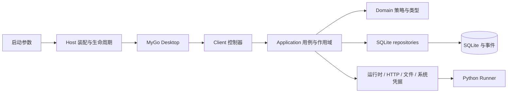

# Go + MyGo 原生客户端架构

最后核实：2026-11-26，依据当前 `apps/native`、根脚本、共享契约和共享资源目录。本文维护实现边界，不记录某次测试运行的完成率；阶段证据见[原生实施记录](../ai/plans/2026-11-17-native-desktop-implementation.md)，发布要求见[发布就绪检查](release-readiness.md)。

## 客户端与发布状态

Liberty 的原生重构实现位于 `apps/native`，采用 Go + MyGo 自绘桌面 UI、应用服务和 SQLite。它已有会议、资源、设置、宠物与打工业务实现，仍以隔离候选版交付。当前 `apps/desktop` 的 React/Tauri/Rust 客户端仍是临时生产发布入口和迁移对照；这不构成长线兼容承诺。Native 达到全部切换门槛后，生产入口切换与旧客户端源码/发布链删除必须在同一退役变更中完成。

两端共用版本化数据与协议事实来源，但有各自的进程、UI、平台适配和凭据访问实现。原生窗口不使用 WebView，也不调用 Tauri command；Tauri capability JSON 不直接赋予 Go 窗口任何权限。

## 模块职责

以下路径均相对 `apps/native/`：

| 目录 | 职责 |
| --- | --- |
| `cmd/liberty-native/` | 启动参数、preview/candidate 通道、资料目录选择和启动失败提示 |
| `internal/host/` | 装配资料库、运行时、调度器、凭据及窗口服务；启动恢复和退出收尾 |
| `internal/desktop/` | MyGo 窗口、布局、原生对话框、焦点与可访问语义；不直接承载 SQL 或网络请求 |
| `internal/client/` | 页面控制器、异步请求、轮询、草稿、错误恢复与陈旧响应隔离 |
| `internal/application/` | 用例、服务端口、任务调度、总结流程、窗口作用域、资源与玩法服务 |
| `internal/domain/` | DTO、状态与策略、预算、AI 提示词和响应、导出投影、宠物及工作规则 |
| `internal/infrastructure/repositories/` | SQLite 查询、事务、顺序迁移、备份与恢复 |
| `internal/infrastructure/runner/`、`execution/`、`managed/` | Python 进程、协议、任务 lease、运行时下载与校验 |
| `internal/infrastructure/ai/`、`remote/` | 受信目标、凭据传输和有界 HTTP 响应 |
| `internal/infrastructure/profile/`、`credentials/`、`system/` | 资料锁、系统凭据和平台实现 |
| `internal/desktop/presentation/`、`internal/contracts/` | UI 共用资源和嵌入契约；生成文件由根脚本维护 |

人员 Excel 解析器只校验文件、XML 与单元格格式；应用导入入口构造 `domain.MemberImport`，一次校验批次姓名、重复与记录人数，并以私有存储的批次类型交给仓储。单条人员保存是独立入口，保留自身实体约束。农场/打工的阶段时间、进度、奖励与汇总计算维护在 `domain/work_rules.go`；仓储保留事务与 SQL，视图使用类型化业务错误选择双语提示。

## 会议工作流

主窗口负责工作台、新建、队列、详情、资源和设置。已完成任务进入独立结果窗口，再打开同任务的总结或只读纪要窗口；模型、模板与人员使用独立编辑器。窗口持有进程内能力对象，限定来源、任务或资源身份；窗口关闭或授权替换后不得继续发布迟到写入。

原生标题栏每秒采样客户端及当前子进程（含 Python Runner / ffmpeg）的 CPU 和内存。CPU 使用系统累计用户态与内核态时间之差，100% 表示一个核心，不能将多核占用截断为 100%。macOS 通过 `libproc` 读取 physical footprint（含压缩内存）；Windows 读取进程驻留工作集（含共享页）。两种内存口径在悬停说明中区分，均以 MiB 展示。首次 CPU 尚无差分基线、采样失败或数据超过 3 秒时显示 `—`；窗口隐藏或最小化暂停采样，恢复时立即重新取样。标题栏不再展示按窗口像素推算的图形内存；没有可靠的进程 GPU 计数时不填估算值。采集在基础设施适配，串行轮询及生命周期在 `client`，视图只渲染快照。

本地任务每次处理一个媒体文件。原生文件选择产生不透明授权，创建时重新核验文件身份，媒体路径不进入公共 UI DTO。调度以持久化 `job_runs`、attempt/lease 和 `job_events` 为依据，进度和文本日志仅作投影。完成、失败和重试不能跨 lease 覆盖，删除先记录持久意图，再终止进程、隔离文件并删除数据。

并发设置是上限。预算保留操作系统与桌面内存，按 ASR 进程预算和 CPU 线程数降低实际并发；默认 8 GiB 设备单任务运行。文件任务仍每次启动独立 Runner。实时会话使用独立常驻 ASR/VAD 进程，会话内只加载一次，并与文件 ASR 互斥。

实时转写与翻译由 `application.LiveService`、`client.LiveController`、`desktop.LiveView` 和基础设施采集/翻译适配构成。macOS/Windows 分别使用固定 ffmpeg 的 AVFoundation/DirectShow 输入，音频通过有界 PCM 队列和独立 `liberty-live-asr` v1 协议送入 `live_runner.py`。临时文字仅在内存，定稿和状态事件写 SQLite；翻译由 `execution.LocalTranslator` 通过独立 JSON Lines 协议调用本地 CTranslate2/Argos 模型，固定 CPU int8 和单线程，不依赖总结模型、凭据或网络请求。暂停释放采集、结束刷尾块并终止进程，切页或最小化不中断会话。详情与产品边界见[实时翻译](../live-translation.md)。

处理模式取自 `processingMode`，不是由 `backendUrl` 是否为空自动决定。远端使用 `liberty-meeting` v1 能力协商；列表、详情、结果、重试、删除和讲话人改名分别检查能力。当前客户端没有开放远端上传创建和远端 AI 总结写入；本地文本导出只消费已授权的远端投影，不能当作服务端导出支持。

远端结果窗口绑定打开时的 URL、凭据引用和 Token 快照。连接改变使后续操作失效；仅切换主窗口处理模式不把旧窗口转向新连接。网络读取不占用整个窗口注册表的锁。

## AI、导出与文件边界

AI 总结由用户主动发起。应用服务保存输入快照、分块、attempt 和 lease，关闭总结窗口不取消已经接受的任务。失败重试使用原运行快照；已接受操作的回读失败应只刷新，不再次发起生成。

OpenAI 兼容响应的正式字段按大小写精确匹配；typed envelope 的重复字段拒绝，未知扩展忽略。首个 choice 必须正常 `stop`，内容必须有完整的结构化字段；内部 JSON 对象沿用 Value 的后值覆盖语义。保存分块和完成运行前均重新校验，非法响应不能发布总结、纪要或成功事件。具体见 [AI 模块](../../apps/native/internal/infrastructure/ai/README.md)。

结果导出按当前授权重新读取数据，沿用原 TXT/Markdown/DOCX 契约。文本和 Word 文件使用同目录暂存、数据同步、目标身份复核与原子发布；取消或失败不发放导出奖励。旧非结构化摘要首次生成纪要时保留有效正文，已有结构化纪要仍为权威内容。

人员 XLSX 使用有界 ZIP/XML、精确数据区域和 OOXML 字符串处理；完整解析后才按姓名事务合并。取消或末尾损坏不能导入前半段。见 [Excel 模块](../../apps/native/internal/infrastructure/memberxlsx/README.md)。

## 数据、接管与凭据

SQLite 当前 schema 为 v12，维护实时会话、定稿字幕和状态事件，并记录自动翻译方向。两端共用 `packages/desktop-resources/database/` 下的 SQL 和内置总结模板；Go 从共享源生成 SQL 并由自己的执行器升级。旧 Rust 实现导出的 v0–v10 合成库、期望输出和文档已冻结在 `packages/desktop-resources/fixtures/native-v10/`，当前兼容入口校验并重放这些样本，不再运行旧客户端。`legacydb` 负责兼容读取，`jobdb` 负责事务写入。干净检出的完整重建仍须独立验收，不能仅从工作区样本存在推断已完成。

preview 必须选择显式快照或目录。candidate 无参数启动使用独立候选资料目录。`--database` 和 `--default-profile` 始终只读；生产资料使用离线 `--import-profile <源目录> --profile-directory <不存在的新目录>` 导入独立 Native 资料。目标按同一只读事务取得包含 WAL 的 SQLite 快照，迁移后给现用凭据分配独立随机引用，不继承源库清理所有权。源快照有排队、执行、删除、总结或安装中的操作时拒绝导入。重复导入验证已发布身份，不覆盖目标后续数据；导入不迁移安装运行时文件或用户媒体。显式可写目录和恢复拒绝与生产资料重叠。

可写启动先持有 profile 锁，再建立或验证接管恢复点。首次接管、schema 升级和恢复前安全快照有不同用途；不能复制运行中的 SQLite 主文件替代 WAL 一致性备份。恢复须验证快照、schema 和凭据引用，在写入前保存安全副本。进入恢复写入后返回错误不保证数据库字节未变化。

API Key 与 Token 只保存在 Keychain / Windows Credential Manager，数据库保存引用。新凭据暂存前持久化清理意图，系统写入后回读比较，随后事务发布引用。清理同时检查现用记录与可恢复快照；被快照引用的凭据延期回收。恢复时外部凭据引用日志跨越 SQLite 覆盖，完成 FULL 提交、checkpoint 和同步后才移除。操作步骤与限制见[原生模块说明](../../apps/native/README.md)。

## 运行时和共享来源

`packages/desktop-resources/runtime/runtime-manifest.json` 是两端唯一的运行时清单，同目录 `models.json` 固定默认模型版本。根配置固定生产 Python 3.11.18 和 FunASR local2 元数据修正版。`productionInputs` 绑定标准库 builder、三锁和五件构建输出；安装器校验固定上游原包和所有产物，从私有快照按哈希安装。`candidateProfiles.security-candidate` 仍是独立显式候选配置。固定归档、平台哈希锁、模型映射、输入摘要和安装 profile 必须同时匹配；支持范围限四个固定 FunASR 模型，不包含 Transformers 5.x 的 Torch 后端。

托管安装在 pip 前检查完整 CPython 版本，之后校验依赖、离线预热和模型目录。Go 在从已有就绪标记确认 Python 可用时，核对解释器文件身份、大小、修改时间和 SHA-256。首次检查或指纹变化时重新运行完整版本探针，探针通过且文件未改变才缓存结果。候选随包输入仍需联网安装。支持目标统一为 macOS Apple Silicon、macOS Intel 和 Windows x64；各目标仍需独立运行时与窗口验收。

| 事实来源 | Go 同步命令 |
| --- | --- |
| `packages/shared-types/schemas/` | `pnpm native:contracts:generate` |
| `packages/desktop-resources/database/` 的 SQL 与内置总结模板 | `pnpm native:migrations:generate` |
| `packages/desktop-resources/runtime/`、Runner 与平台锁 | `pnpm native:runtime:generate` |
| `packages/desktop-resources/templates/meeting-minutes.docx` | `pnpm native:export:generate` |
| `packages/desktop-resources/i18n/` 与 `presentation/` | `pnpm native:presentation:generate` |
| `packages/desktop-resources/images/` 农场与工作素材 | `pnpm native:work-art:generate` |
| `packages/desktop-resources/` 的 `pet/`、`images/pet/` 和 `redemption/` | `pnpm native:pet:generate`、`pnpm native:pet-art:generate`、`pnpm native:redemption:generate` |

上述生成器从共享源、Runner 和平台锁读取输入。`native:compat` 使用独立、脱敏且逐文件验证摘要的历史黄金样本；Native 的恢复 journal、跨进程锁和文件写入使用自己的回归测试。当前检查不再证明运行中的 Go/Rust 双向互操作。旧端 inventory 脚本、基线和专用测试已移除。资源清单及维护方法见[桌面共享资源](../../packages/desktop-resources/README.md)。

## UI 与玩法约束

主页面和系统设置共用 `presentation` 主题及 `desktop/kit.go` 导航状态渲染，不为设置页再定义底色、图标色或选中色。中英文消息来自同一类型化消息源。列表、弹窗、焦点和加载/失败状态必须保持可访问语义。

主导航采用 52 px 模块图标栏和 232 px 当前模块菜单。图标栏保留工作、打工、资源、伙伴、福利入口，设置固定在底部；菜单仅显示当前模块的功能。进入设置时保留图标栏并切换为设置分类，窄于或等于 760 px 的设置视图将两级导航依次排列在内容上方。图标有中英文可访问名称、悬浮说明和当前位置语义；任务详情、农场与小游戏归属其上级模块，点击已选模块不重置当前页面。模块跳转仍由现有应用能力判定，缺少能力的入口不可操作。

macOS 的深浅配色通过 AppKit 的 `NSColor` 语义角色分别在 Aqua/Dark Aqua 中解析，包括窗口、文本背景、标签、分隔线与系统填充色；跨平台回退使用中性色。界面和设置缩略图共用这些色值，强调色不改变阅读区域底色。Liquid Glass 选项为“透明／色调”（`transparent`／`tinted`）：透明在系统 Regular 玻璃之上覆盖 96% 不透明的中性窗口色，只保留轻微背景透感；色调使用完全不透明的中性窗口色，不透出桌面。该强度是 Liberty 主窗口的产品设定，不等同于 AppKit 的 Clear／Regular 枚举，也不依赖原生 tint 参数来保证遮蔽效果。设置缩略图使用相同的背景合成规则。显式深浅切换及系统外观变化都会更新窗口材质。macOS 26 及以上由系统绘制 Liquid Glass，旧 macOS 使用对应的模糊材质，Windows 11 22H2 及以上使用 Acrylic；无窗口材质的系统、减少透明度或高对比度模式使用不透明底色。右侧阅读内容与表单始终保持实色背景及既有圆角裁剪。

会议队列在 repository 的同一只读事务内计数、筛选和分页，只装配当前十条任务及其源文件；Unicode 子串搜索与领域规则一致。空闲队列每五秒检查，有活动任务或读取失败时每秒检查。已完成的本地结果先检查 SQLite 数据修订号，数据库未提交变化时复用窗口快照；连接替换必须使修订失效。修订探测沿用结果窗口的来源和撤销校验，远端服务没有修订支持时继续回读。活动任务仍读取独立进度文件，手动重试及内容变更不能被缓存吞掉；总结和导出时间等元数据变化复用未变的逐字稿存储与筛选索引。

运行环境页面可见时空闲每五秒刷新，隐藏时每三十秒刷新，安装进行中每秒刷新；宠物页面隐藏时仅同步概要与桌宠设置。未变化的后台队列、结果和运行环境不主动触发重绘。侧栏吉祥物在有活动会议任务时播放动画，空闲显示静帧。商店商品行使用 MyGo 虚拟列表；共享图片仍从生成源维护，解码时按显示用途缩小。宠物和工作图片 LRU 分别限制强引用的基础 RGBA 像素为 8 MiB 与 24 MiB；可见窗口仍持有的图片通过弱引用复用。这是缓存预算，不是进程 RSS、GPU 纹理或缩放层的总预算。

原生应用菜单注册 MyGo 的标准关闭窗口角色，支持系统关闭快捷键，并经过已有未保存草稿与设置保存保护。菜单标题和关闭文案随中英文设置切换，不另建关闭或窗口生命周期逻辑。

设置连续保存时，每笔成功持久化的快照都须立即同步到工作区的生效模式；后续排队保存失败不能让主窗口继续显示已被替换的旧模式。未保存的草稿仍保留供重试。连接检查、退出等依赖整批草稿保存的动作，须等待所有排队写入成功；一次失败后的手动重试不得自动重放之前的后续动作。语言变更同步更新已打开的结果、总结和纪要窗口内容及系统窗口标题，保留窗口绑定的会议标题；异步授权完成后新建的结果窗口使用当时已生效的语言。

历史迁移审计记录过旧端 25 条路由、90 个 command 和 8 项窗口 capability；对应旧端 inventory 检查已移除，这些计数不代表当前持续验证。逐页的新旧截图差分、全部交互状态、多窗口焦点、输入法、系统文件对话框与读屏仍需实机验收。当前远端列表、详情、结果、重试、删除和讲话人改名按能力开放；远端新建任务没有安全上传协议，原生 UI 不开放创建入口。旧端创建调用同样未实现安全分块上传，不能据此推断旧版可成功创建远端任务。

宠物、LP、商店、签到、盲盒、兑换、农场和打工规则见[宠物系统](../pet-system.md)。工作流奖励尽力写入，不得阻塞会议主业务。原生工厂装配练习是临时会话，不保存成绩或结算 LP；“需照看”时可选用成功练习调用既有 Care 用例，原一键照看保留，局内分数不改变经济。固定时钟差分已覆盖直接照看、稳妥单与错配急单的跨日持久化、阶段推进、领取和重放；玩法校准、可选照看实窗、强杀及断电仍按小游戏工作线独立验收。

## 验证边界

`native:verify` 是不调用旧端的原生完整本地检查入口；根 `pnpm check` 先执行它，再完成退役前的临时生产检查，共享 Python 只执行一次。根质量工作流按改动范围选择检查，没有定时任务和默认候选打包。`build-native.yml` 仅手动或显式调用，要求包含临时生产端与安全扫描的共同完整门禁通过后才交付候选；归档的文件集合、架构、manifest 和摘要须在上传前独立核验。它没有正式发布或生产放行步骤，详见 [CI/CD 规则](ci-cd.md)。

开发检查、跨语言差分、竞态检测、跨目标编译、真实运行时、系统凭据、原生交互、依赖扫描与签名安装验收分别执行，不能相互替代。命令和环境见[开发指南](../development.md)。UI 组件截图不证明原生输入法或读屏验收；本机测试不证明 Intel/Windows，候选打包不代表生产切换。

## 共同安全与证据要求

HTTP 适配在发送凭据或会议内容前校验目标，按各自策略拒绝不允许的协议、URL 内嵌凭据、重定向、私网/链路本地目标和混合公私 DNS 结果，并固定已验证地址。允许的本机回环服务仍遵守模块的明确策略。文件输出、归档和模型目录执行路径及链接检查；诊断只输出有界、脱敏的信息，不能记录凭据、逐字稿、提示词或用户媒体路径。

依赖、扫描器和许可证规则由现有供应链配置维护。缺扫描器或扫描执行失败不能报告为安全通过；带期限的例外不消除漏洞，也不自动延期。补丁包保留上游身份、来源/补丁摘要和许可证，SBOM 与发布资产绑定确切版本及摘要。

更换 ASR 引擎、运行时或模型必须核对受控媒体、版本化人工标注、CER/WER/DER、资源与耗时指标，以及同一提交/模型集的目标设备证据。8 GiB 是性能档位，高内存设备不能代替该档位；缺样本、标注或目标设备证据应标记未验证。具体要求分别由[ASR 验证资产](../../benchmarks/asr/README.md)和[发布就绪检查](release-readiness.md)维护。
